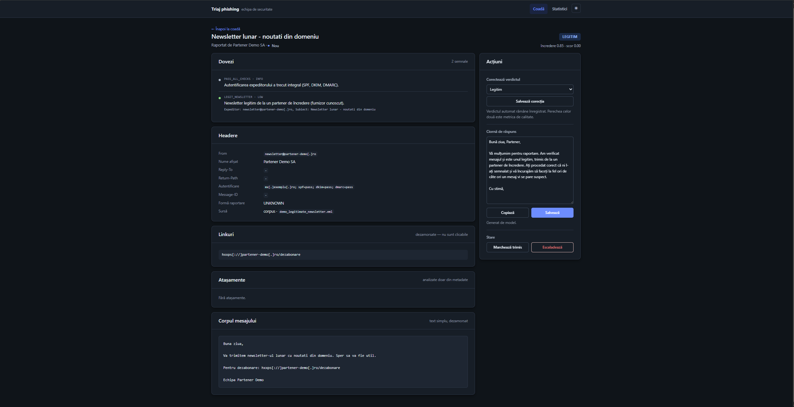
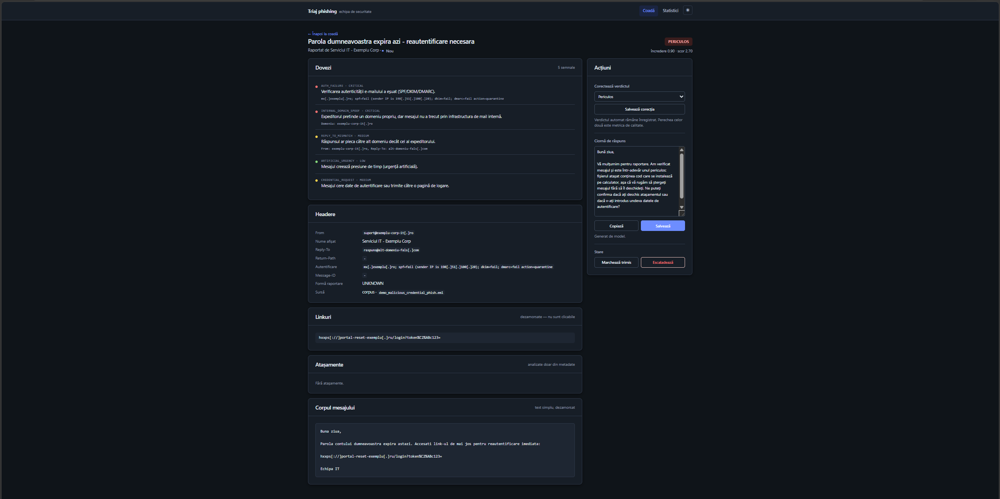
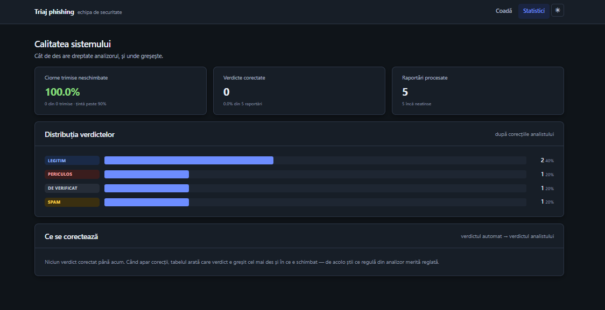
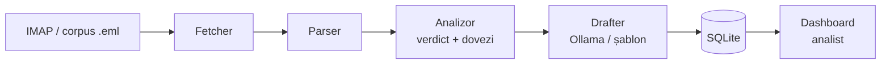

<div align="center">

#  Triaj phishing

**Asistent local de triaj pentru mail-urile de phishing raportate de colegi.**
Verdict determinist, cu dovezi. Ciornă de răspuns în română. Decizia aparține analistului.


</div>

---

## De ce există

Într-o echipă de securitate, fiecare mail suspect raportat de un coleg înseamnă
că: cineva îl citește, îl analizează, scrie un răspuns. Când există o
campanie de simulare, sosesc zeci de raportări aproape identice care consumă
timp fără să aducă informație nouă.

Acest proiect preia partea repetitivă și lasă analistului doar decizia.

> ### Ideea centrală
> **Verdictul nu este dat de un model de AI.** Este dat de reguli de cod, testabile și
> auditabile: fiecare decizie vine cu lista de dovezi care a dus la ea.
> Modelul local (Ollama) doar scrie textul de răspuns, *după* ce verdictul
> e stabilit, și nu îl poate schimba.
>
> De ce: un model care „halucinează" un „e sigur, poți da click" trimis unui
> angajat e un incident de securitate. Cu reguli, poți explica oricând exact
> de ce sistemul a decis ce a decis.

---

## Cum arată

### Coada de lucru

Fiecare raportare apare cu verdict, scor de încredere (bară colorată), status
și dată. Filtrele pe status și verdict sunt rapide, iar acțiunile în masă
(„marchează trimis", „escaladează") merg pe mai multe rapoarte deodată.

### Detaliu raport

Dovezile sunt colorate pe severitate, ca analistul să vadă rapid prioritatea.

<table>
<tr>
<td width="50%" align="center"><b> Legitim</b><br><sub>o dovadă pozitivă, ciornă care încurajează raportarea</sub></td>
<td width="50%" align="center"><b> Periculos</b><br><sub>5 semnale coroborate, ciornă care cere ștergerea</sub></td>
</tr>
<tr>
<td></td>
<td></td>
</tr>
</table>

Headerele sunt dezamorsate, linkurile nu pot fi accesate prin click, corpul mesajului e
text curat (niciodată HTML randat), iar ciorna se editează și se copiază direct
din pagină.

### Statistici



Cât de des are dreptate analizorul și unde greșește. Metrica principală e rata
ciornelor trimise neschimbate: dacă analiștii le rescriu pe toate, aici se vede
exact unde trebuie îmbunătățit sistemul.

>  Tema întunecată se comută din header și se păstrează între sesiuni.
>
> *Capturile folosesc exclusiv date fictive din `corpus/demo/`. Nicio
> raportare reală și nicio dată de companie nu apare în imagini.*

---

## Ce face, pe scurt

| | |
|---|---|
| 🔍 **Analiză deterministă** | SPF/DKIM/DMARC, spoofing de domeniu intern, domenii lookalike, homoglife și punycode, TLD cu risc, atașamente periculoase, link cu text diferit de destinație |
|  **Scor coroborat** | Semnalele slabe se adună: trei indicii medii pot justifica împreună un verdict pe care niciunul nu îl justifică singur |
|  **Ciornă în română** | Ollama local, cu fallback pe șabloane statice dacă modelul e picat sau dă un răspuns invalid |
|  **Dashboard pentru analist** | Listă, detaliile cu dovezi, corectare de verdict, statistici de calitate, temă întunecată |
|  **Offline prin construcție** | Nu accesează URL-urile raportate, nu deschide atașamente, nu trimite mail |
|  **Componente independente** | Dacă pică Ollama sau dashboard-ul, restul sistemului nu se blochează |

### Cele 5 verdicte

| Verdict | Când | Ciornă |
|---|---|---|
| `SIMULATION` | Fingerprint confirmat al platformei de simulare | Neutră, fără să dezvăluie natura mesajului |
| `MALICIOUS` | Semnale clare de phishing sau malware | Mulțumește, cere ștergerea, întreabă dacă s-a dat click |
| `SPAM` | Marketing nesolicitat, fără risc | Recomandă dezabonarea sau blocarea, după liniștire |
| `LEGITIMATE` | Mail real, doar cu încredere ridicată | Confirmă și încurajează raportarea |
| `NEEDS_REVIEW` | Semnale insuficiente sau contradictorii | **Fără ciornă**: decide analistul |

---

## Pornire rapidă

Ai nevoie doar de **Python 3.12+**. Ollama e opțional: fără el, ciornele vin
din șabloane și totul merge la fel.

```bash
git clone https://github.com/SabinaAflorei/phishing-analyzer.git
cd phishing-analyzer

make setup      # creează .venv, instalează tot, copiază fișierele de configurare
make corpus     # 12 cazuri sintetice de test
make ingest     # procesează corpusul și umple coada
make run        # dashboard pe http://127.0.0.1:8000
```

Deschide `http://127.0.0.1:8000`, ar trebui să vezi 12 raportări cu verdicte.
Oprești serverul cu `Ctrl+C`.

Vrei să verifici înainte că totul e în regulă?

```bash
make test       # 359 de teste, cu rețeaua blocată
```

### Configurare

`make setup` copiază trei fișiere din variantele `.example`. Niciunul nu intră în git.

| Fișier | Conține | Trebuie editat? |
|---|---|---|
| `config/settings.yaml` | sursă, căi, LLM, dashboard | nu, merge așa |
| `config/company_domains.yaml` | domeniile companiei, partenerii de încredere | **da** |
| `.env` | credențiale IMAP | doar pentru mailbox real |

În `config/company_domains.yaml` pui domeniile reale, hostname-urile serverelor
de mail și adresa la care raportează angajații. De ele depind regulile de
spoofing intern, lookalike și TLD cu risc. Dacă îl lași necompletat, sistemul
pornește pe varianta `.example` și scrie un avertisment în log.

>  **Fă backup înainte de orice experiment.** Fișierul e exclus din git, deci
> o suprascriere greșită nu se recuperează cu `git checkout`:
> `cp config/company_domains.yaml config/company_domains.yaml.backup`

### Ollama (opțional)

```bash
ollama pull qwen2.5:7b-instruct
```

Modelul se alege în `config/settings.yaml`, la `llm.model`. Pentru a opri complet
LLM-ul: `llm.enabled: false`. Pe CPU, fără GPU, o ciornă durează 30-90 de secunde,
așa că `llm.timeout_seconds` e setat la 90.

### Mailbox real (IMAP)

Conexiunea e **read-only**: nu șterge, nu mută și nu marchează nimic. Completezi
credențialele în `.env`, pui `source: imap` în `config/settings.yaml` și pornești
`make poll`. Înainte de a conecta un mailbox real, validează configurarea cu
echipa responsabilă de securitate.

---

## Comenzi

| Comandă | Ce face |
|---|---|
| `make setup` | venv, dependențe, fișiere de configurare |
| `make corpus` | generează corpusul sintetic de test |
| `make ingest` | un ciclu de ingestie din sursa configurată |
| `make poll` | ingestie la interval, până la `Ctrl+C` |
| `make run` | dashboard pe `127.0.0.1:8000` |
| `make test` | testele, cu rețeaua blocată |
| `make ci` | ruff + mypy + teste, verde înainte de PR |
| `make clean` | șterge cache-urile și `build/` |

Din linia de comandă, după `make setup`:

```bash
triage ingest                 # un ciclu de ingestie
triage list --status NEW      # ce e în coadă
triage list --verdict SPAM    # filtrat pe verdict
triage show 3                 # un raport, cu dovezi și ciornă
triage check mail.eml         # analizează un .eml fără să-l salveze nicăieri
triage check mail.eml --json  # același lucru, pentru scripting
```

---

## Cum e făcut

Patru componente independente care comunică **doar** prin SQLite. Niciuna nu o
cheamă direct pe următoarea.



De aici vin trei proprietăți pe care se sprijină restul:

- **Ollama picat** → verdictele se produc oricum, ciorna vine din șablon.
- **Dashboard oprit** → ingestia continuă și scrie în baza de date.
- **Bug în drafter** → excepția e prinsă pentru mailul respectiv, raportul se
  salvează fără ciornă, restul cozii trece mai departe.

| Modul | Rol |
|---|---|
| `triage/fetcher` | IMAP read-only și sursa offline de `.eml`. Nu șterge, nu mută, nu marchează. |
| `triage/parser` | Scoate mesajul **original**, nu partea colegului care a raportat. |
| `triage/analyzer` | Verdictul determinist. Fără AI. Fiecare semnal produce o dovadă. |
| `triage/drafter` | Ciorna în română: Ollama dacă răspunde, șablon static altfel. |
| `triage/db` | Tabelul `reports`, singurul loc prin care componentele se văd. |
| `triage/pipeline` | Drumul complet, folosit de CLI, dashboard și poll. |
| `triage/dashboard` | Coada, partea cu detalii, statisticile. |

<details>
<summary><b>Cum se calculează verdictul</b></summary>

<br>

Toate regulile rulează, fără întrerupere timpurie, iar dovezile se adună.
Ponderile stau într-un singur tabel, `SIGNAL_WEIGHT` din `triage/analyzer`, și
două praguri decid:

- **≥ 1.0** e suficient pentru obținerea `MALICIOUS`: eșec de autentificare,
  atașament periculos, spoofing de domeniu propriu.
- **Sub 1.0**, un semnal are nevoie de coroborare. Reply-To nepotrivit, urgență
  artificială și cerere de credențiale, luate împreună, ajung la un verdict pe
  care niciunul nu îl justifică singur.
- **Între 0.4 și 1.0** se obține `NEEDS_REVIEW`, cu dovada că semnalele s-au
  coroborat fără să atingă pragul. Decizia o face un analist.

Regula pe care o respectă tot analizorul: severitatea unei dovezi și ponderea ei
sunt analizate împreună. Un semnal de severitate `MEDIUM` nu poate produce singur `MALICIOUS`.

</details>

---

##  Securitate

Ce **nu** face sistemul, prin construcție:

- ❌ Nu accesează niciun URL raportat, nu rezolvă DNS pe el, nu descarcă nimic.
  Testele rulează cu socket-urile blocate: dacă cineva adaugă un request către un
  domeniu raportat, suita pică.
- ❌ Nu deschide atașamentele. Verdictul vine din metadate: nume, extensie,
  dimensiune, SHA256 și flagul de criptare din headerul ZIP.
- ❌ Nu randează HTML din mail. Dashboard-ul arată doar text dezamorsat.
- ❌ Nu trimite mail. Ciorna o copiază și analistul o trimite manual .
- ❌ Nu ascultă în afara `127.0.0.1`. Configurarea respinge orice altceva la
  pornire, la fel și un `llm.base_url` care nu e pe loopback.

Tot ce iese din sistem e **dezamorsat** (`hxxps[://]exemplu[.]com`), inclusiv în
baza de date, locul cel mai ușor de omis.

**Apărare împotriva prompt injection.** Textul trimis modelului e curățat întâi:
tag-uri `script`/`style`, elemente ascunse prin stil (`display:none`, 1px, alb pe
alb), caractere Unicode invizibile, apoi trunchiat la `llm.max_input_chars`.
Răspunsul modelului e validat structural (salut, corp, încheiere); dacă nu
respectă forma, e eliminat și se folosește șablonul. Există un test dedicat care
arată că verdictul rămâne neschimbat chiar dacă mailul conține instrucțiuni
ascunse pentru model.

<details>
<summary><b>Înainte de prima ingestie reală</b></summary>

<br>

- [ ] Snapshot al VM-ului, făcut o dată.
- [ ] Rulează `scripts/check_bind_localhost.sh` și verifică să nu fie nimic expus
      în afara loopback.
- [ ] Exclude `data/` din backup-urile automate. Directorul are un `CACHEDIR.TAG`
      pe care borg, restic și `tar --exclude-caches` îl respectă; pentru alte
      soluții, excluderea e explicită.
- [ ] Validează cu echipa de securitate înainte să conectezi mailbox-ul real.

</details>

---

## Corpusul de test

| Director | Conține | În git? |
|---|---|---|
| `corpus/eml/` | raportări **reale** (nume de colegi, contacte externe, URL-uri cu token) | ❌ niciodată |
| `corpus/expected/` | doar verdictul așteptat și codurile de dovezi obligatorii | ✅ |
| `corpus/demo/` | mailuri complet fictive, folosite pentru capturile din acest README | ✅ |
| generat de `make corpus` | 12 înlocuitori sintetici, cu aceeași structură MIME și date inventate | ✅ |

Un test care trece pe corpusul sintetic arată că pipeline-ul funcționează pe
**forma** mailurilor, nu pe mailurile reale. Când ai corpusul real, îl copiezi
peste în `corpus/eml/` și rulezi din nou.

---

## Modelul ales

**`qwen2.5:7b-instruct`**, ales după o evaluare comparativă cu `llama3.1:8b`. A
fost singurul care n-a dezvăluit niciodată natura de simulare pe categoria
`SIMULATION`, criteriul de siguranță cel mai important. Latența (30-90s pe CPU)
rămâne peste bugetul țintă de 30s. Detalii și cifre în
[`docs/decisions/0004-modelul-pentru-drafter.md`](docs/decisions/0004-modelul-pentru-drafter.md).

Pentru a reevalua pe alt hardware sau cu alt model:

```bash
python3 scripts/eval_model.py --models qwen2.5:7b-instruct,llama3.1:8b --runs 5 --out build/eval.md
```

---

## Limitări cunoscute

- **IMAP** e implementat (retry, idempotență) dar neconectat la un mailbox real.
- **Latența ciornelor** (30-90s fără GPU) depășește ținta de 30s.
- **Îmbogățirea externă** (reputație URL, vârsta domeniului) e oprită implicit:
  `enrichment.enabled: false`, în spiritul offline-first.
- **Ciorna e o propunere.** Poate adăuga detalii care nu sunt în dovezi, de aceea
  trece mereu prin analist înainte de trimitere.

---

<details>
<summary><b>🔧 Probleme întâlnite frecvent</b></summary>

<br>

**`ImportError: cannot import name ... from partially initialized module`**
Import circular între `triage/settings.py` și `triage/drafter`. Importul
clientului Ollama stă sub `if TYPE_CHECKING:`, iar importul real e local, în
funcția care chiar are nevoie de el.

**`yaml.scanner.ScannerError`, doar în CI, niciodată local**
Aproape sigur `.example.yaml` are o eroare de sintaxă pe care n-o vezi local,
fiindcă acolo există mereu fișierul real (exclus din git). Simulează absența lui
(`mv` temporar) și rulează testele.

**Teste care pică cu `IndexError` când lipsește `corpus/eml/`**
Testului îi lipsește markerul de skip pentru corpus. Folosește markerul comun
din `tests/`, definit o singură dată.

**Text invizibil în tema întunecată**
Un `style="color: #hex"` hardcodat în șablon ignoră variabilele de temă. Regula:
nicio culoare inline în șabloane, totul prin variabilele CSS din `app.css`.

</details>

---

## Dezvoltare

```bash
make ci          # ruff + mypy + pytest: verde înainte de orice PR
```

Branch per funcționalitate, PR către `main`, review înainte de merge. Mesajele de
commit spun **ce** s-a schimbat și **de ce**. Deciziile de arhitectură sunt în
[`docs/decisions/`](docs/decisions/): ce s-a decis, de ce, și ce s-a dat la schimb.

Nu intră niciodată în git: `data/`, `.env`, `config/settings.yaml`,
`config/company_domains.yaml`, `corpus/eml/`, `corpus/msg/`.
